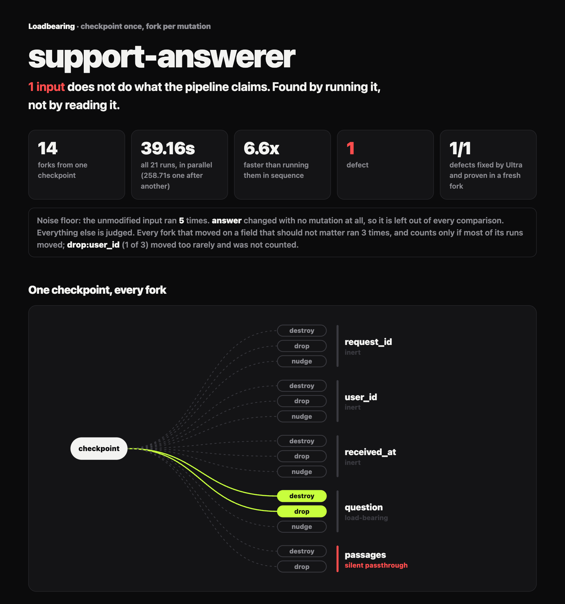
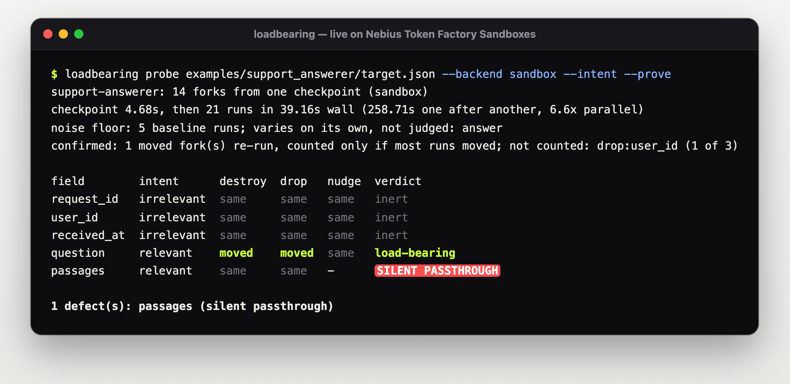
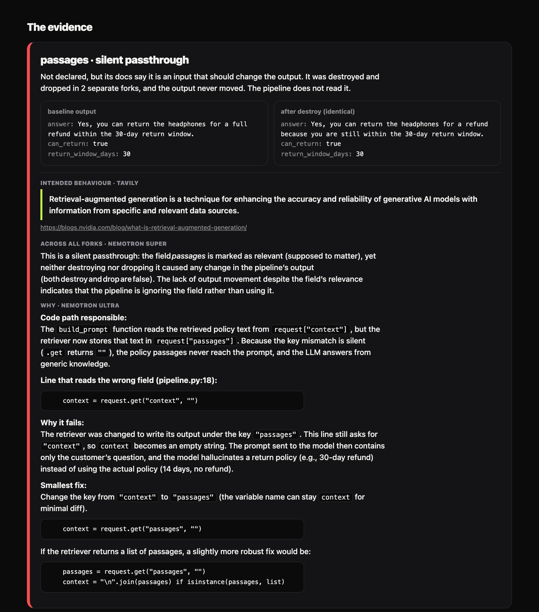
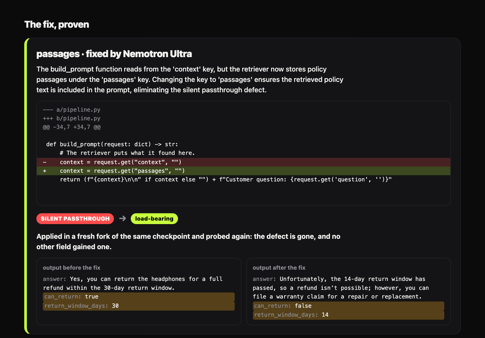
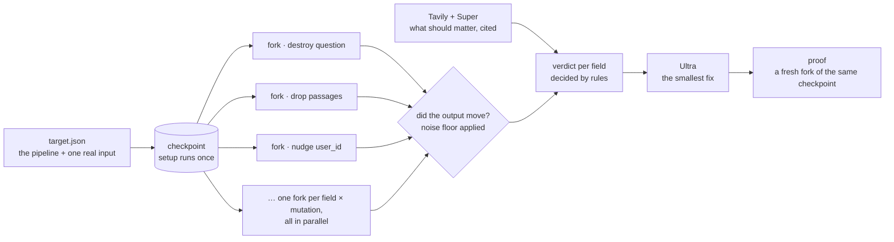
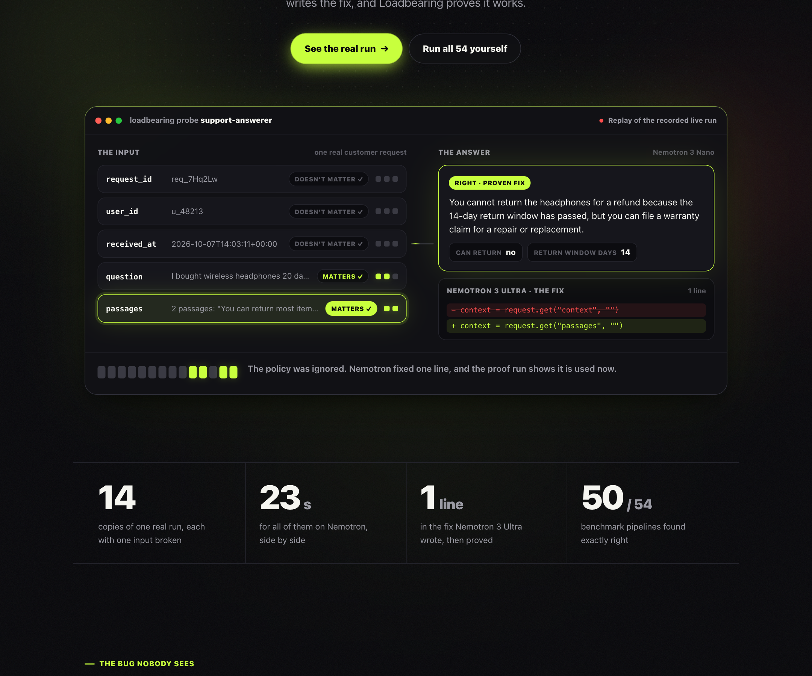

<div align="center">

# Loadbearing

**Find out which inputs a pipeline is actually load-bearing on, by running it.**

<a href="https://github.com/varunikarai/loadbearing/actions/workflows/ci.yml"></a> <a href="LICENSE"></a>    <a href="https://loadbearing-demo.vercel.app"></a>

<br><br>

<picture>
  <source media="(prefers-color-scheme: light)" srcset="docs/img/report-hero-light.png">
  
</picture>

<sub>The report from a live run: Nemotron 3 on Nebius Token Factory, the checkpoint and every fork in Nebius Sandboxes. Every image on this page is Loadbearing's real output from live runs; the terminal is drawn from the captured text of one.</sub>

</div>

Loadbearing checkpoints a pipeline once, in a Nebius Token Factory Sandbox or on your own machine, forks that checkpoint once per input mutation, runs every fork in parallel from the same snapshot, and reports two defect classes:

- **Silent passthrough**: an input that should matter was destroyed, and the output did not move.
- **Phantom sensitivity**: an input that should not matter was nudged, and the output moved.

The problem statement is in [SPEC.md](SPEC.md).

<p align="center">
  <a href="#see-it-work">See it work</a> ·
  <a href="#how-it-works">How it works</a> ·
  <a href="#quickstart">Quickstart</a> ·
  <a href="#in-ci">In CI</a> ·
  <a href="#benchmark">Benchmark</a> ·
  <a href="#the-demo-server">Demo server</a> ·
  <a href="#prior-art">Prior art</a>
</p>

## See it work

A support bot answers from retrieved policy. The retriever writes the policy into `passages`;
the prompt builder reads `context`. Nothing throws, every type checks, and the bot tells a
customer something the policy does not say:

| | Before | After Ultra's fix, proven in a fresh fork |
|---|---|---|
| `answer` | "Yes, you can return the headphones for a full refund within the 30‑day return window." | "Unfortunately, the 14‑day return window has passed, so a refund isn’t possible; however, you can file a warranty claim for a repair or replacement." |
| `can_return` | `true` | `false` |
| `return_window_days` | `30` | `14` |

One command finds it, explains it, fixes it and proves the fix:

<p align="center"></p>

<details>
<summary>The full terminal output of that run</summary>

```
$ loadbearing probe examples/support_answerer/target.json --backend sandbox --intent --prove
support-answerer: 14 forks from one checkpoint (sandbox)
checkpoint 4.68s, then 21 runs in 39.16s wall (258.71s one after another, 6.6x parallel)
noise floor: 5 baseline runs; varies on its own, not judged: answer
confirmed: 1 moved fork(s) re-run, counted only if most runs moved; not counted: drop:user_id (1 of 3)

field        intent      destroy  drop   nudge  verdict
request_id   irrelevant  same     same   same   inert
user_id      irrelevant  same     same   same   inert
received_at  irrelevant  same     same   same   inert
question     relevant    moved    moved  same   load-bearing
passages     relevant    same     same   -      SILENT PASSTHROUGH

1 defect(s): passages (silent passthrough)

why passages:
  intent: "Retrieval-augmented generation is a technique for enhancing the accuracy and reliability
          of generative AI models with information from specific and relevant data sources."
          (https://blogs.nvidia.com/blog/what-is-retrieval-augmented-generation/)
  Super:  This is a silent passthrough: the field *passages* is marked as relevant (supposed to
          matter), yet neither destroying nor dropping it caused any change in the pipeline’s output
          (both destroy and drop are false). The lack of output movement despite the field’s
          relevance indicates that the pipeline is ignoring the field rather than using it.
  Ultra:  Code path responsible:
          The `build_prompt` function reads the retrieved policy text from `request["context"]`, but
          the retriever now stores that text in `request["passages"]`. Because the key mismatch is
          silent (`.get` returns `""`), the policy passages never reach the prompt, and the LLM
          answers from generic knowledge.

          Line that reads the wrong field (pipeline.py:18):
                  context = request.get("context", "")

          Why it fails:
          The retriever was changed to write its output under the key `"passages"`. This line still
          asks for `"context"`, so `context` becomes an empty string. The prompt sent to the model
          then contains only the customer’s question, and the model hallucinates a return policy
          (e.g., 30‑day refund) instead of using the actual policy (14 days, no refund).

          Smallest fix:
          Change the key from `"context"` to `"passages"` (the variable name can stay `context` for
          minimal diff).

                  context = request.get("passages", "")

          If the retriever returns a list of passages, a slightly more robust fix would be:
                  passages = request.get("passages", "")
                  context = "\n".join(passages) if isinstance(passages, list)

fix for passages (silent passthrough):
  Ultra:  The build_prompt function reads from the 'context' key, but the retriever now stores
          policy passages under the 'passages' key. Changing the key to 'passages' ensures the
          retrieved policy text is included in the prompt, eliminating the silent passthrough
          defect.
--- a/pipeline.py
+++ b/pipeline.py
@@ -34,7 +34,7 @@
 
 def build_prompt(request: dict) -> str:
     # The retriever puts what it found here.
-    context = request.get("context", "")
+    context = request.get("passages", "")
     return (f"{context}\n\n" if context else "") + f"Customer question: {request.get('question', '')}"
proof: passages is now load-bearing, and no other field gained a defect.
```

The bot samples its answers, so two runs can differ by chance. The noise floor showed `answer`
varies on its own, so a fork that moved on a field that should not matter ran three times and
counted only if most of its runs moved. In this run that kept one chance answer, on a `user_id`
fork (moved 1 of 3), from being reported as a phantom sensitivity. Only those moves are re-run:
they are the ones a chance answer could turn into a false defect.

</details>

**The evidence.** `passages` was never declared as an input that matters. Tavily read the guide
the target names, NVIDIA's own page on retrieval-augmented generation; Super quoted it, and that
turned "the output never moved" into a cited defect. Ultra then named the line.

<p align="center">
<picture>
  <source media="(prefers-color-scheme: light)" srcset="docs/img/report-evidence-light.png">
  
</picture>
</p>

**The fix, proven.** Ultra quotes the one line it changes. The fix is applied in a fresh fork of
the *same* checkpoint and probed again: the defect is gone and no other field gained one.

<p align="center">
<picture>
  <source media="(prefers-color-scheme: light)" srcset="docs/img/report-proof-light.png">
  
</picture>
</p>

## How it works



1. **Checkpoint once.** The pipeline's setup runs once and is snapshotted, so every fork starts from the same state.
2. **Fork per mutation.** Each input field is destroyed, dropped and nudged, one at a time, each in its own fork, all in parallel.
3. **Compare against a noise floor.** The unmodified input runs several times first; output keys that change on their own (an LLM's wording) are set aside. On a pipeline that is not deterministic, a fork that moved on a field that should not matter runs twice more and counts only if most of its runs moved, so one chance answer is never reported as a defect.
4. **Decide by rule.** A field that should matter and never moves is a *silent passthrough*; a field that should not matter and moves is a *phantom sensitivity*. With `--nano`, Nano decides whether a change is meaningful or noise; whether that makes a defect is a rule, never a model's call.
5. **Fix and prove.** Ultra writes the smallest edit; the probe reruns from the same checkpoint, so the fix is the only thing that differs.

## How it uses Nebius and NVIDIA

| Piece | Job |
|---|---|
| Token Factory Sandboxes | The setup run with `disposable=False` is the checkpoint. Every fork is a run from that snapshot with one mutated input, so the only thing that differs between forks is the input. |
| Nemotron Nano | One call per moved fork: is the change meaningful, or noise? |
| Nemotron Super | Reconciles every fork on a field into one defect statement |
| Nemotron Ultra | Reads the pipeline source and explains why a path does or does not read the field |
| Tavily | Fetches upstream docs that establish what a pipeline is supposed to read |

## Quickstart

Python 3.10 or later. The core has no dependencies.

```bash
git clone https://github.com/varunikarai/loadbearing.git
cd loadbearing
PYTHONPATH=src python3 -m loadbearing probe examples/ticket_triage/target.json
```

```
ticket-triage: 15 forks from one checkpoint (local)
checkpoint 0.01s, then 17 runs in 0.07s wall (0.46s one after another, 6.5x parallel)

field          intent      destroy  drop   nudge  verdict
ticket_id      irrelevant  same     same   same   inert
submitted_at   irrelevant  moved    moved  moved  PHANTOM SENSITIVITY
customer_tier  relevant    moved    moved  moved  load-bearing
subject        relevant    moved    moved  moved  load-bearing
body           relevant    same     same   same   SILENT PASSTHROUGH

2 defect(s): submitted_at (phantom sensitivity), body (silent passthrough)
```

The ticket body reports a full outage, and the pipeline still says P3, because it reads the body under a misspelled key. Nothing throws and the output is well-formed. The exit code is 1 whenever a defect is found, so a probe can gate CI.

### On Nebius Sandboxes

```bash
pip install -e '.[sandbox]'
cp .env.example .env        # set NEBIUS_API_KEY and NEBIUS_PROJECT_ID, or run `contree auth` once
loadbearing probe examples/ticket_triage/target.json --backend sandbox
```

### With Nemotron judging each diff

```bash
cp .env.example .env        # set NEBIUS_API_KEY
loadbearing models          # prints the Nemotron IDs your key can call; paste them into .env
loadbearing probe examples/ticket_triage/target.json --nano
```

### Find, fix, prove

```bash
loadbearing probe examples/ticket_triage/target.json --fix     # Ultra writes a fix per defect
loadbearing probe examples/ticket_triage/target.json --prove   # ...and a fresh fork proves each one
```

With `--prove`, the probe and every proof share one checkpoint, so a fix is the only thing that
differs. Each proof says whether the defect is gone and whether any other field gained one. A
fix is refused before it runs if it quotes text that is not in its file exactly once, touches a
file outside the target's `sources`, no longer compiles, changes nothing, or rewrites most of a
file. A fix is never called proven if the patched pipeline crashes on the real input or leaves
nothing stable to judge. The exit code still reflects the pipeline as given. `--baseline-runs N` overrides the target's noise floor.

### The LLM demo target

```bash
loadbearing probe examples/support_answerer/target.json --intent --prove
# needs NEBIUS_API_KEY, NEMOTRON_NANO_MODEL, NEMOTRON_SUPER_MODEL, NEMOTRON_ULTRA_MODEL, TAVILY_API_KEY
```

A support answerer over retrieved policy text. The retriever writes `passages`, the prompt reads
`context`, so a customer 20 days into a 14-day return window is told they have 30 days for a full
refund. Its target leaves `passages` undeclared on purpose: without `--intent` the probe only
observes that the answer never moves when the passages are destroyed. With `--intent`, Tavily
reads the RAG guides the target names (NVIDIA's own) and searches for more; Super settles the
field from the named guides first and from search results only if they say nothing, quotes the
line saying the model answers from what it retrieved, and that observation becomes a cited silent
passthrough. The proven fix makes the answer 14 days and a warranty repair.

## In CI

```yaml
- uses: actions/checkout@v4
- uses: varunikarai/loadbearing@main
  with:
    target: path/to/target.json      # args: "--baseline-runs 5" for an LLM pipeline
```

The job fails when a probe finds a defect, and the run page shows the verdict table, each
defect, and any proven fix as a job summary. `fail-on-defects: "false"` reports without
failing; the `defects` output carries the count.

On Nebius, with Nemotron judging each diff, pass the keys from repository secrets:

```yaml
- uses: varunikarai/loadbearing@main
  with:
    target: path/to/target.json
    args: --backend sandbox --nano
  env:
    NEBIUS_API_KEY: ${{ secrets.NEBIUS_API_KEY }}
    NEBIUS_PROJECT_ID: ${{ secrets.NEBIUS_PROJECT_ID }}
    NEMOTRON_NANO_MODEL: ${{ vars.NEMOTRON_NANO_MODEL }}
```

## The report

```bash
loadbearing probe examples/ticket_triage/target.json --out report.json --html report.html
loadbearing report report.json            # re-render a saved run without re-running it
```

`report.html` is one self-contained page: the checkpoint fanning out to every fork, the
field-by-mutation matrix, and, for each defect, the baseline and fork outputs side by side
with the changed keys marked. It fetches nothing, so a saved copy always opens.

## The demo server

**Live at [loadbearing-demo.vercel.app](https://loadbearing-demo.vercel.app).** The front page replays the recorded support answerer run copy by copy, from the ignored policy to the proven fix, then lets you run any free target yourself: one card at a time, or all 54 benchmark cases at once, each checked against the bug planted in it. The support answerer shows its recorded live run, since running it would spend credits.

<p align="center">
<picture>
  <source media="(prefers-color-scheme: light)" srcset="docs/img/demo-index-light.png">
  
</picture>
</p>

```bash
loadbearing serve                                     # http://127.0.0.1:8000
loadbearing serve --backend sandbox --nano            # runs on Nebius, Nano judging each diff
loadbearing serve --readonly --targets examples --targets bench/cases
```

It lists every `<dir>/<name>/target.json`, one section per `--targets` folder, runs a probe on
one when asked, and caches the result in `runs/`, so a page view never costs a run. With
`--readonly`, anything free still runs (a target with no keys, on the local backend, with no
model calls), and anything that would spend credits on Sandboxes or Nemotron is shown as its
recorded run instead. The Dockerfile runs it on any container host that sets `$PORT`, and
`api/index.py` runs the same pages as a Vercel function; [demo/README.md](demo/README.md) has both.

## Benchmark

54 small pipelines with planted input-handling bugs ([bench/](bench/)), three ways of finding them:

| detector | cases fully right | defects found | false alarms | seconds |
|---|---|---|---|---|
| Loadbearing (runs it) | 50 of 54, every run | 48 of 49 | 3 | 4 |
| Nemotron 3 Super reads the code | 49 to 51 of 54 over three runs | 45 to 47 | 1 | ~200 |
| Static name check (reads it) | 26 of 54 | 35 of 49 | 22 | 0 |

On pipelines this small, a strong model reading the code finds about as much as running it.
The difference is repeatability: the model's answer changes from run to run at temperature 0,
including which cases it gets wrong, and every run it raised a false alarm on one clean
pipeline. Loadbearing gives the same answer every run, shows the forks that justify it, and
proves the fix. Against the static check, exact McNemar on cases: p = 1.9e-05. Against the
model, the difference is not significant (p = 0.38). The misses and false alarms are listed
case by case; how the cases are built and what this does not show: [bench/README.md](bench/README.md).

## Writing a target

<details>
<summary>Every key a target file can hold</summary>

A target is a JSON file next to the pipeline it describes.

| Field | Meaning |
|---|---|
| `name` | Label for the report |
| `image` | OCI image the sandbox starts from |
| `setup` | Runs once, before the checkpoint is taken |
| `files` | Copied into the checkpoint |
| `command` | Runs in every fork. The fork's record is at `input.json` |
| `record` | The baseline input |
| `expects.relevant` | Fields that should change the output. Never moving is a silent passthrough |
| `expects.irrelevant` | Fields that should not. Moving is a phantom sensitivity |
| `timeout` | Seconds a single run may take. Default 60 |
| `baseline_runs` | How often the unmutated record runs, for the noise floor. 2 or more, default 2 |
| `env` | Variable names passed from the host to baseline and fork runs only, never to setup |
| `docs` | `{"query": ..., "urls": [...]}`: where Tavily looks for what the pipeline should read. The `urls` are the pipeline's own docs and are read first; the `query` only settles what they leave open |
| `sources` | Files a fix may rewrite. Default: `files` |

Undeclared fields are still probed and reported, but never flagged as defects. Every key after
`expects` is optional, so a target written for the first version still loads unchanged. Field
paths use dots between levels (`customer.tier`), so a record key that itself contains a dot is
refused before anything runs.

</details>

## Layout

<details>
<summary>Where each piece lives</summary>

```
src/loadbearing/
  mutations.py       one mutation, one field: destroy, drop, nudge
  probe.py           checkpoint once, fork per mutation in parallel, compare, judge
  compare.py         did the output move, and which keys
  verdict.py         silent passthrough, phantom sensitivity
  noise.py           the noise floor: keys that vary with no mutation
  target.py          target file loader
  backends/local.py  directory snapshot, for development with no account
  backends/contree.py  Nebius Token Factory Sandboxes
  nemotron.py        Token Factory client, Nano / Super / Ultra routing
  tavily.py          Tavily search and extract client
  intent.py          what undeclared fields should do, quoted from the pipeline's docs
  net.py             one JSON request, retried on a rate limit, a 5xx or a dropped connection
  fix.py             a fix, and the checks it passes before any fork applies it
  prove.py           re-probe a fix from the same checkpoint; the whole loop
  report.py          the versioned JSON report
  html_report.py     the self-contained HTML report and fork tree
  markdown_report.py the Markdown summary for CI job summaries
  serve.py           the demo server
  cli.py             loadbearing probe | report | serve | models
examples/ticket_triage/     toy pipeline with two planted bugs
examples/support_answerer/  LLM pipeline on Nemotron that ignores what it retrieved
```

</details>

## Tests

```bash
PYTHONPATH=src python3 -m unittest discover -s tests
```

Every test runs offline, with no key. Nemotron and Token Factory are replaced by fakes, including
a fake Token Factory server that the LLM demo target talks to over HTTP, unmodified.

## Status

Built and tested offline unless it says live. Nemotron, Tavily and the Sandboxes backend have all run live on Token Factory.

- [x] Mutation engine: destroy (template-replace), drop, nudge
- [x] Checkpoint-and-fork engine, timed: checkpoint, parallel wall time, and the same runs one after another
- [x] Verdicts: silent passthrough and phantom sensitivity
- [x] Noise floor: the baseline runs `baseline_runs` times, and keys that vary on their own are set aside
- [x] Confirmed moves: on a pipeline that is not deterministic, a fork that moved on a field that should not matter is re-run, and counts only if most of its runs moved
- [x] Close the loop: Ultra writes the fix as exact-quote edits, validated before use; a fresh fork of the same checkpoint proves it, and a fix that crashes on the real input is never called proven
- [x] An LLM demo target: a support answerer over retrieved policy, with a planted rename bug
- [x] Report schema 2 and a self-contained HTML report: the fork tree, the evidence, the proven fix
- [x] Demo server with cached runs and a read-only mode; Dockerfile; CI with a probe gate and a clean-clone check
- [x] Secrets reach forks only, never a checkpoint
- [x] A paid run survives a rate limit or a dropped connection (retried with backoff), and a fork that hangs is recorded, not fatal
- [x] Prior art: metamorphic testing, leave-one-feature-out, input erasure
- [x] Benchmark: 54 pipelines with planted bugs, against a static check and Nemotron reading the code ([bench/](bench/))
- [x] GitHub Action with a job summary
- [x] Live: Nemotron Nano, Super and Ultra on Token Factory. Nano scored 19 of 20 labelled diffs on each of three runs; Super and Ultra explain each defect and write the fix
- [x] Live: Tavily inferring which fields should matter. On the support answerer it finds a RAG source saying answers come from the retrieved passages, which makes the unread `passages` field a defect; Ultra's one-line fix is proven, and the answer goes from "30 days, refund" to "14 days, warranty"
- [x] Live: the Sandboxes backend. The toy target finds the same two defects on Nebius (checkpoint 4.4 s, then 17 runs in 5.3 s, 7.6x parallel), and the support answerer's whole loop, intent, fix and proof, ran there and is the recorded run
- [x] Hosted demo at [loadbearing-demo.vercel.app](https://loadbearing-demo.vercel.app): free targets run on request, paid runs are shown as recorded
- [ ] Demo video

## Prior art

- **Metamorphic testing** (Chen, Cheung and Yiu, 1998) checks relations between runs on transformed inputs; Loadbearing's relations are per field and come from intent.
- **Leave-one-feature-out** (Sculley et al., NeurIPS 2015) finds inputs a model barely uses; Loadbearing applies the idea to any running pipeline and also flags the input it should use but silently does not.
- **Input erasure** and **sensitivity analysis** measure what an input changes; Loadbearing adds a defect claim per field, a noise floor for LLM output, and a fix proven from the same checkpoint.
- **"Lost in the Middle"** (Liu et al., TACL 2024) shows why a retrieval pipeline can answer without using what it retrieved.

Sources, differences in full, and documented real failures: [docs/prior-art.md](docs/prior-art.md).

## License

[Apache 2.0](LICENSE)
